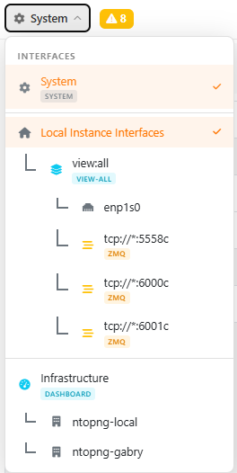

# System Interface {#system-interface}

The System Interface GUI is used to monitor the status of the System on which ntopng is running.

By changing interface and jumping instead to the System Interface other options are going to be available.

## Health {#health}

- [System](/user_interface/system_interface/health/system.md)
  - [Historical Charts](/user_interface/system_interface/health/system.md#historical-charts)
  - [Internals](/user_interface/system_interface/health/system.md#internals)
  - [Hash Tables](/user_interface/system_interface/health/system.md#hash-tables)
  - [Periodic Activities](/user_interface/system_interface/health/system.md#periodic-activities)
  - [Degraded Performance](/user_interface/system_interface/health/system.md#degraded-performance)
  - [Checks](/user_interface/system_interface/health/system.md#checks)
- [Interfaces](/user_interface/system_interface/health/interfaces.md)
- [Redis](/user_interface/system_interface/health/redis.md)
- [InfluxDB](/user_interface/system_interface/health/influxdb.md)
- [ClickHouse](/user_interface/system_interface/health/clickhouse.md)

