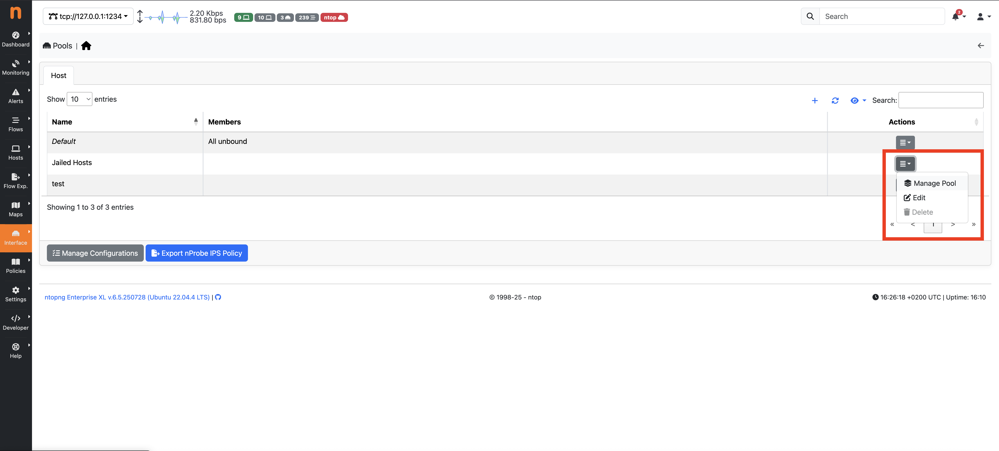
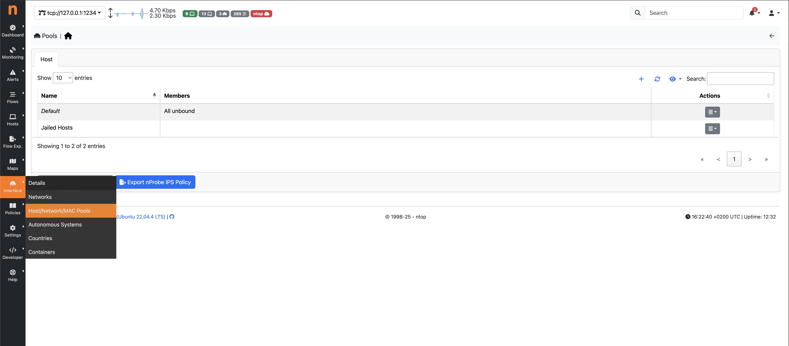
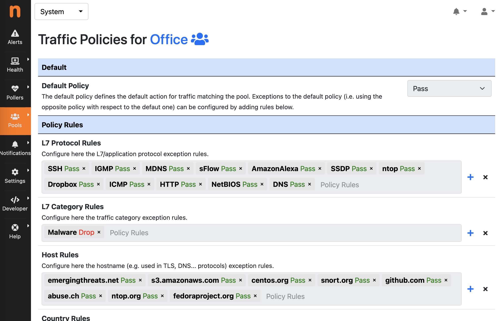
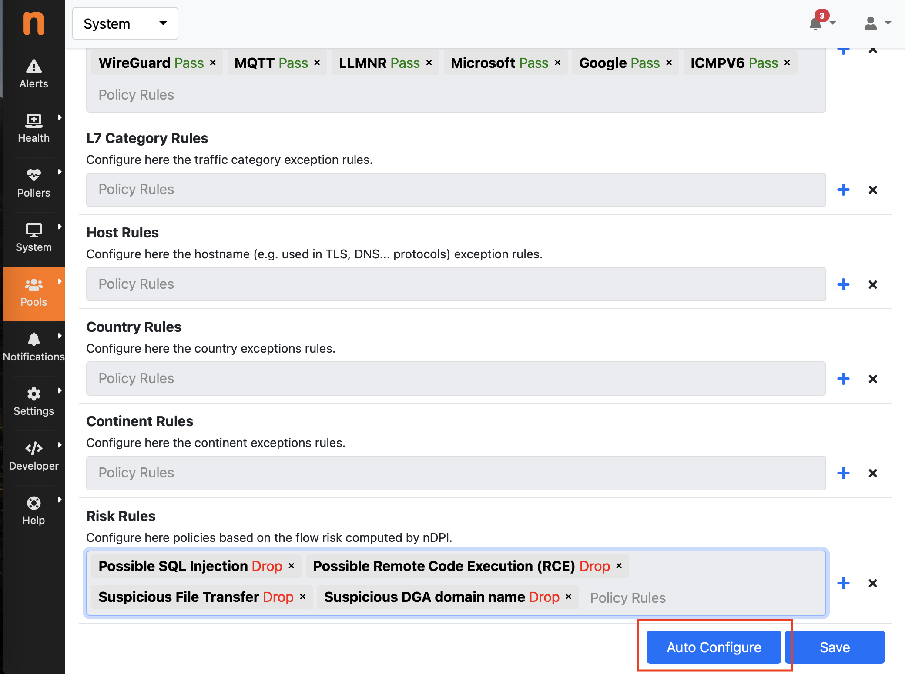

<a id="usingntopngwithnfw"></a>

# Using ntopng with nEdgeLite {#using-ntopng-with-nedgelite}

ntopng can be used to enforce traffic policies when used in combination with
[nEdgeLite](https://www.ntop.org/guides/nedgelite).

::: info
A ntopng Pro or Enterprise license is required.
:::

Traffic policies are automatically exported to nProbe after a change to the policies configuration, or
when a new nProbe instance connects to ntopng via ZMQ. In order to publish policies to an additional ZMQ channel
configure the ntopng ZMQ endpoint for IPS events. Example:

```bash
nedgelite -q 0 -z tcp://ntopng-host:5556 -p tcp://ntopng-host:5557
ntopng -i tcp://127.0.0.1:1234 --zmq-publish-events tcp://*:5557
```

Please refer to the [nEdgeLite documentation](https://www.ntop.org/guides/nEdgeLite/ntopng_integration.html) for more
details about the nEdgeLite configuration and ntopng integration.

A different traffic policy can be configured for each pool of hosts (see [Host Pools](/user_interface/network_interface/interface/host_pools.md#hostpools)) by selecting the pool to edit, in the dropdown icon ('Actions column'), click 'Manage Pool'



then on the “key” button in the *Interface* > *Host/Network/MAC Pools* page to edit the selected pool.



The policies configuration includes a default policy, that can be Pass or Drop (Default Deny), and
more specific rules that can be used to configure exceptions with respect to the default policy, including:

- L7 Application Protocol Rules
- L7 Category Rules
- Host Rules to configure hostnames used in TLS and DNS protocols for instance
- Country Rules
- Continent Rules
- Risk Rules to apply policies based on the Flow Risk computed by nDPI



An *Auto Configure* functionality is also available to automatically create a recommended configuration
for the Traffic Policy by leveraging on the protocols/hosts seen by ntopng for the devices belonging to the Pool
(please note ntopng should run for at least 1 day in order to get the best results). Please note that this
configuration is a *guess* and should be manually fine tuned. This feature is particularly useful in case of
devices which are supposed to use a limited/static set of services, which is the case of *IoT devices* for
instance. In this case the *Default Policy* is set to Drop (*Default Deny*) and the *Auto Configure*
functionality adds those L7 protocols and hostnames which are actually required for the device to work
(according to the historical data). In order to populate *Host Rules*, the *Top Visited Sites* heuristic
should be enabled under *Settings* > *Preferences* > *Applications*.


